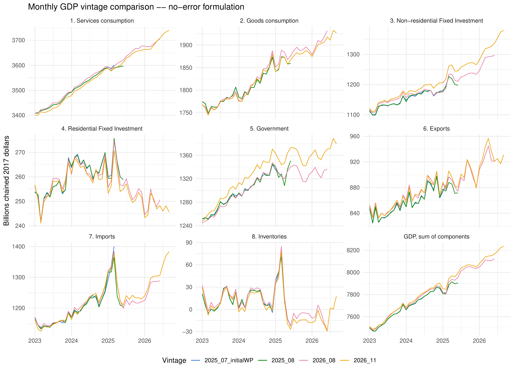

# Monthly data releases

Pre-built output — if you just want the estimated monthly series, grab a file
here rather than running the model yourself. Each folder has two files:

- `monthly_nipa_no_err.xlsx` — the baseline estimates (abstracts from
  chain-linking aggregation error)
- `monthly_nipa_with_err.xlsx` — the alternate estimates, which include it
  (GDP here sums almost exactly to BEA's published quarterly total; see the
  paper for the aggregation-error discussion)

Both contain the same six sheets: `level`, `trend`, `hat` (percent departure
from trend), `full_se`, `smoother_se`, and `ks_param_se` — monthly GDP and its
8 NIPA components, 1950 to the most recent complete GDP quarter.

| Folder | Vintage | Sample ends |
|---|---|---|
| [`2025_07_initialWP/`](2025_07_initialWP) | As published in the original IMF working paper | 2025-03 |
| [`2025_08/`](2025_08) | Prior update | 2025-06 |
| [`2026_08/`](2026_08) | Prior update | 2026-06 |
| [`2026_11/`](2026_11) | Current | 2026-09 |

To reproduce these yourself, or regenerate on newer data, see the main
[README](../README.md).

## Vintage comparison

One panel per component, overlaying every vintage above (no-error formulation)
so you can see how each series has revised release-to-release. PDF version:
[`compare_vintages_no_err.pdf`](compare_vintages_no_err.pdf).

